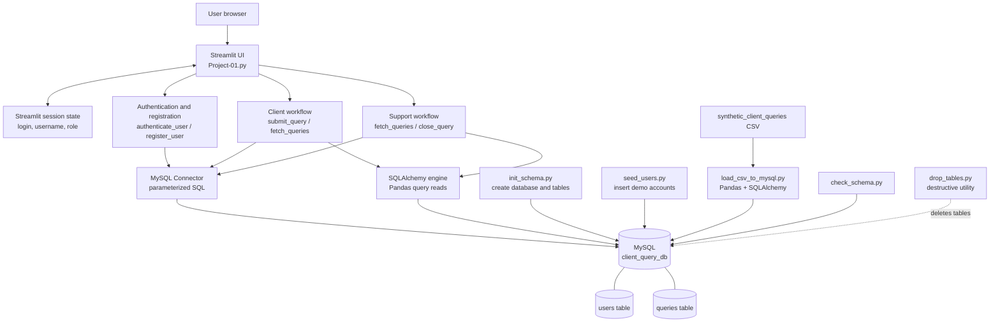

# Client Query Management System — Architecture

## Request flow

1. A user opens the Streamlit app in a browser and logs in or registers.
2. The app checks or writes account data in the MySQL `users` table.
3. A client submits a query; the app inserts it into `queries` with `Open` status.
4. Clients see query rows filtered using their username/email. Support users can search and filter the full list and close an open query.
5. The CSV loader is an optional separate path for importing sample query rows.

## Notes

- The application has two database access styles: MySQL Connector for writes and SQLAlchemy/Pandas for reads.
- The current schema does not define a foreign key linking a query to a user, and the app does not use a SQL `JOIN`.
- The app uses role selection at registration and SHA-256 password hashing. These are demo limitations, not production security recommendations.
- `drop_tables.py` removes both application tables and should be treated as destructive.
