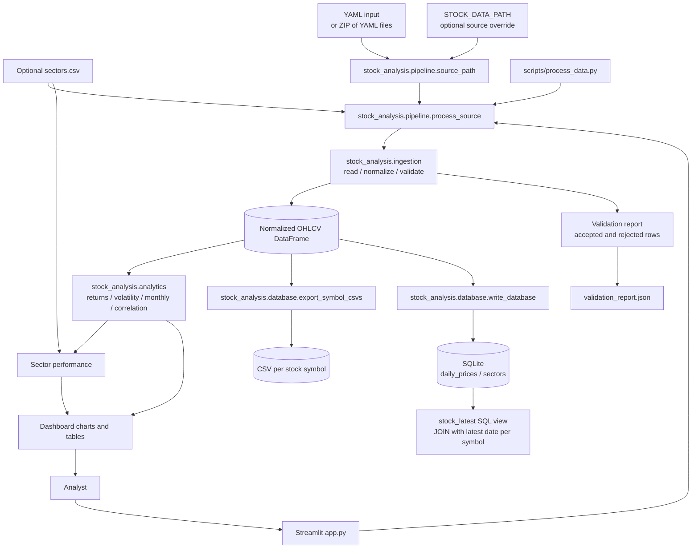

# Data-Driven Stock Analysis — Architecture

## Data flow

1. `source_path()` selects a configured YAML/ZIP source or searches the expected raw-data locations.
2. `load_yaml()` and `normalize_records()` turn nested source records into consistent symbol/date/OHLCV rows and produce a validation report.
3. `calculate_metrics()` validates prices and calculates stock, monthly, and market metrics.
4. The pipeline exports one sorted CSV per symbol, writes SQLite tables and a `stock_latest` view, and saves `validation_report.json`.
5. The Streamlit dashboard presents the processed metrics and charts.

## Notes

- The processing CLI and Streamlit dashboard both use `process_source()` as the common pipeline.
- SQLite persistence is separate from dashboard analytics. The SQL view joins each symbol's daily records to its latest available date.
- Source data is required; the project should not fabricate market observations. Results are historical analysis, not investment advice.
