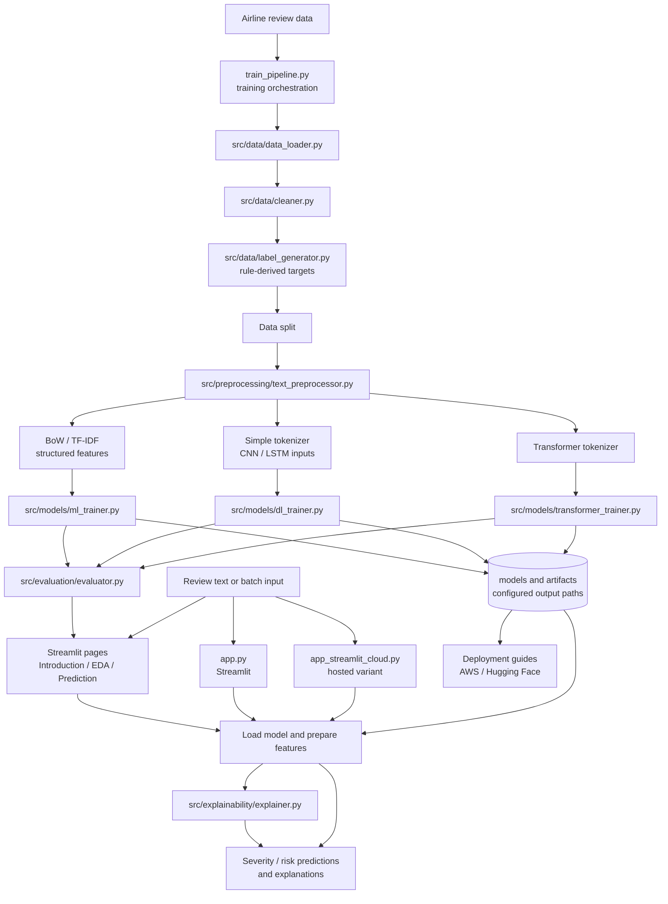

# Airline Complaint AI - Fixed copy — Architecture

This diagram describes the separate project copy at `airline-complaint-ai-fixed/airline-complaint-ai/`. Confirm that copy's own configuration and artifacts before running it.

## Architecture notes

- This copy has its own nested application folder, `src` modules, pages, training code, tests, and deployment guides. It is separate from the sibling `airline-complaint-ai` directory.
- Training and inference share preprocessing and feature definitions; the saved vectorizer, tokenizer, scaler, and model artifacts need to match.
- Severity and risk labels come from configured rules and are not human-verified ground truth.
- The repository includes both an ordinary Streamlit app and a cloud-oriented variant. Deployment requires appropriate dependencies, input data, model artifacts, and secret configuration.
- Do not infer model quality from the diagram; use the actual evaluation output for measured results.
