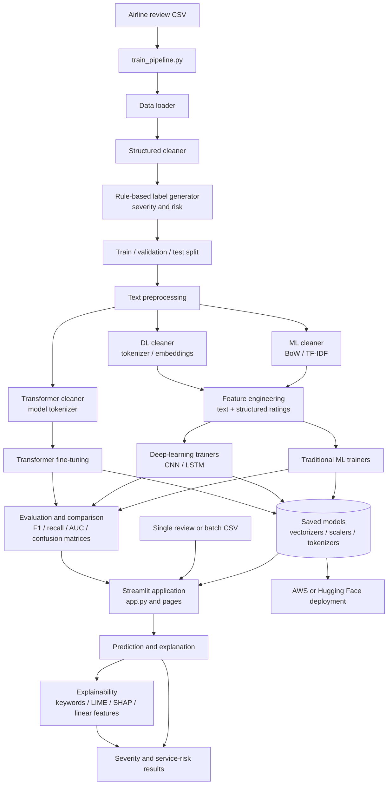

# Airline Complaint AI — Architecture

## Architecture notes

- The training pipeline reads and cleans airline reviews, then creates severity and risk labels from ratings, recommendation fields, aspect ratings, and keyword rules.
- The three text paths are intended for different model families: traditional ML, custom deep learning, and transformer tokenizers.
- Feature vectorizers and scalers should be fit on training data only, then reused for test and inference inputs.
- Evaluation and explanations are separate concerns: evaluation measures model performance; explainability helps describe individual predictions.
- The labels are rule-generated targets, not independently human-annotated ground truth.
- Streamlit pages expose introduction/data information, EDA, and prediction functionality. Saved artifacts must be available at the configured paths for inference.
