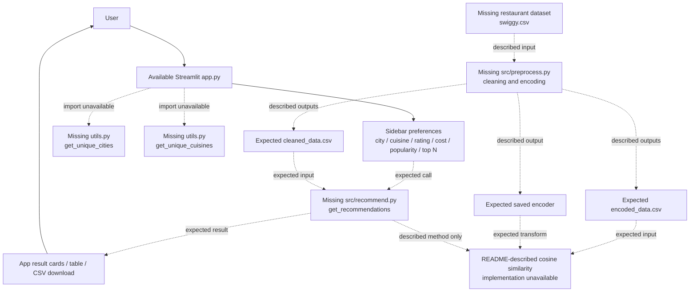

# Swiggy Recommendation — Architecture

> **Source limitation:** The current project copy has the Streamlit `app.py` and a README. The README-referenced preprocessing, recommender, utility, requirements, data, and encoder files are not present. Solid arrows below show visible or documented intended flow; dashed nodes/arrows are not verifiable from the available implementation.

## What is visible in the available app

- The UI requests city, cuisine, a minimum rating, maximum cost, minimum rating count, and a requested number of recommendations.
- On the button click, it calls `get_recommendations(user_input, top_n)`.
- It displays result cards, optional restaurant links, a table view, and a downloadable CSV.
- The app imports `get_unique_cities()` and `get_unique_cuisines()` from a `utils` module that is missing from this copy.

## What the README describes, but cannot currently be verified

The README describes preprocessing, one-hot encoding, and cosine-similarity ranking using restaurant and user-preference features. The source code implementing that behavior and its input/output artifacts are absent. Restore those files before treating the dotted path as the application's verified runtime architecture.
